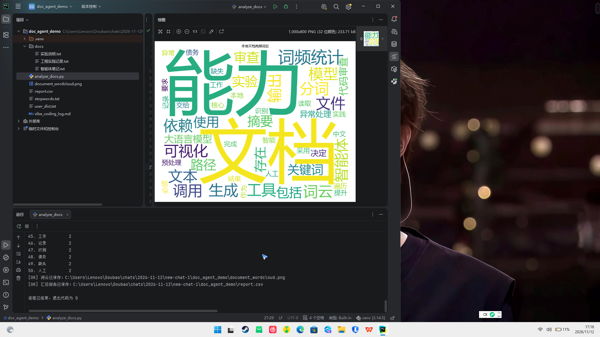

# Python 实验（四）：本地文档智能审查与摘要（Vibe Coding 全流程）

> 本文记录"本地文档智能审查与摘要"实验的完整过程：先由人划定需求边界并写出结构化 Prompt，再由 AI 产码、本地实跑、把报错原文回灌修复，最后在自己 IDE 的项目虚拟环境里跑通。实验最值得记的不是"做出了词云"，而是**两个字体通道的坑**和**跑通不等于没问题**这两点。完整代码与逐轮协作痕迹见文末仓库。

## 实验背景

实验目标是做一个**完全本地运行**的文档批量分析原型：给定一个文件夹，批量读取其中的 `.txt` / `.md`，分词后统计高频词，输出词云图与可直接打开的词频报表。不接任何云服务，也不需要大模型 API，重点在文本预处理链路和可视化落地。

处理链路：

```
目录遍历 → 文本读取 → 加载自定义词典 / 停用词 → jieba 分词
        → 过滤单字与符号 → 词频统计 Top50 → 词云 PNG + CSV 报表
```

- 实验环境：Windows、Python 3.13.16、PyCharm 2026.2.3
- 样本数据：`docs/` 下 3 篇文档（实验说明、智能体笔记、工程实践记录）
- 配置数据：`stopwords.txt`（46 条停用词）、`user_dict.txt`（20 个专业词）
- 第三方依赖：`jieba`、`wordcloud`、`matplotlib`

---

## 一、先把边界定死：结构化 Prompt

Vibe Coding 最容易出的问题不是"AI 写不出代码"，而是**需求没定清，AI 只能猜**。所以第一步不是写代码，而是由人确定四件事：输入是什么、怎么处理、输出什么、有什么硬约束。

实际下发给 AI 的 Prompt 原文：

```
需求背景：开发一个本地文档分析工具，批量处理文件夹中的 txt 文档，提取高频词并生成词云。
明确约束：
1. 使用 os 遍历指定目录下所有 .txt / .md 文件。
2. 使用 jieba 分词，支持加载自定义词典 user_dict.txt 与停用词表 stopwords.txt。
3. 使用 wordcloud 生成词云，显式指定中文字体路径，白底，尺寸 1000x800。
4. 代码需含详细注释，并处理文件读取异常（单个文件失败不影响整体）。
输出要求：完整 Python 代码 + 停用词表/自定义词典的配置说明。
```

Prompt 里没有"帮我做个文档分析"这种模糊表述，而是把**路径、库选型、尺寸、异常策略、输出物**全部写死。AI 据此产出了函数化拆分的 `analyze_docs.py`：`load_stopwords` / `load_user_dict` / `read_folder` / `make_wordcloud` / `save_report` / `analyze`。

---

## 二、环境探测：不假设依赖已就绪

代码能不能跑，取决于本机装了什么。先探测，再安装，不要假设。

```powershell
python --version            # Python 3.13.16
python -c "import jieba, wordcloud, matplotlib"
```

实际报错：

```
ModuleNotFoundError: No module named 'jieba'
```

安装后实际落盘版本：

```powershell
python -m pip install jieba wordcloud matplotlib
# jieba-0.42.1  wordcloud-1.9.6  matplotlib-3.11.2
# 附带 contourpy-1.4.0  cycler-0.12.1  python-dateutil-4.0.0
```

---

## 三、首次实跑：主链路打通

```powershell
$env:MPLBACKEND='Agg'; python analyze_docs.py
```

实际输出（节选）：

```
[OK] 使用字体：C:\Windows\Fonts\msyh.ttc
[OK] 已加载自定义词典：...\user_dict.txt
[OK] 已加载停用词 46 个：...\stopwords.txt
[OK] 共读取 3 个文件，有效词条 345 个

===== Top 50 高频词 =====
 1. 文档         7
 2. 能力         7
 3. 词频统计       5
 4. 文本         4
 5. 分词         4
 6. 词云         4
 7. 可视化        4
 ...
[OK] 词云已保存：...\document_wordcloud.png
[OK] 汇总报告已保存：...\report.csv
```

产物核对：

| 文件 | 实测值 | 说明 |
|---|---|---|
| `document_wordcloud.png` | 约 180 KB | 白底 1000×800 词云 |
| `report.csv` | 711 B | 字段：排名 / 关键词 / 出现次数 |
| `docs/` | 3 篇 | 有效词条 345 个 |

词频最高的词是「文档」「能力」（各 7 次），其后是「词频统计」（5 次）、「文本」「分词」「词云」「可视化」「文件」「输出」「依赖」「生成」「模型」「智能体」「工具」「调用」（各 4 次）。词频分布很平，说明三篇样本是"同一个主题的不同侧面"，没有单一压倒性主题。


---

## 四、最隐蔽的坑：中文字体其实有两个通道

程序"跑通了"，PNG 也生成了，但控制台刷出一堆警告：

```
UserWarning: Glyph 26412 (\N{CJK UNIFIED IDEOGRAPH-672C}) missing from font(s) DejaVu Sans.
  plt.tight_layout()
UserWarning: Glyph 25991 (\N{CJK UNIFIED IDEOGRAPH-6587}) missing from font(s) DejaVu Sans.
```

图上的标题「本地文档高频词云」直接渲染成方框。

**归因**：`wordcloud` 的 `font_path` 只作用于**词云内部的文字**；`matplotlib` 的**标题、坐标轴**走自己的 `rcParams` 字体配置，默认是 DejaVu Sans，没有中文字形。这是两条互不相干的字体通道，只设一个必然踩坑。

**修复（两行）**：

```python
# 【迭代修复】matplotlib 绘图区中文需单独设置字体，否则标题显示为方框
plt.rcParams['font.sans-serif'] = ['Microsoft YaHei', 'SimHei']
plt.rcParams['axes.unicode_minus'] = False
```

修复后重跑，Glyph 警告全部消失，只剩 `FigureCanvasAgg is non-interactive`——这是无界面模式的正常提示，不是错误。

这一步给整份实验定了调：**实验指导书里"必须指定中文字体"的一句话，实际是两处都要设**。如果只按字面理解，标题永远是方框，而很多人会以为"图出来了就算完成"。

---

## 五、分模块迭代：加功能不推翻已有逻辑

首版跑通后按模块追加，每次只动一处，回归成本最低：

| 迭代项 | 指令内容 | 落地位置 |
|---|---|---|
| 高频词报表 | Top50 输出为 CSV | `save_report()` |
| 单文件异常隔离 | 单个文件读失败不中断整体 | `read_folder()` 的 `try/except + continue` |
| 路径前置校验 | 文件夹不存在直接返回提示 | `read_folder()` 开头 `os.path.isdir` |
| 字体多级回退 | msyh → simhei → simsun 自动探测 | `FONT_CANDIDATES` |
| 词性/符号过滤 | 去掉纯符号与单字 | `w.strip().isalnum()` 与 `len > 1` |

其中"字体多级回退"是从这次踩坑里长出来的：把字体路径写成一个候选列表，用 `next((p for p in FONT_CANDIDATES if os.path.exists(p)), None)` 取第一个存在的，换机器就不会因为路径不同而整体失效。

---

## 六、换到自己的 IDE：PyCharm + 项目 venv

同一份代码搬到 PyCharm 里又遇到了 IDE 侧的问题：

1. 打开项目时提示"无解释器"，需先在右下角选择解释器并生成 `.venv`；
2. 命令行里装过依赖，IDE 里仍报 `ModuleNotFoundError`——因为装到了系统 Python，而不是项目 venv。正确做法是一律用 `.venv\Scripts\python.exe -m pip`：
   ```powershell
   .\.venv\Scripts\python.exe -m pip install -i https://pypi.tuna.tsinghua.edu.cn/simple jieba wordcloud matplotlib
   ```
3. 项目树右键 `analyze_docs.py` → 运行，输出与命令行一致，末尾 `进程已结束，退出代码为 0`。

PyCharm 运行结果留档：



IDE 侧踩坑小结：

| 现象 | 根因 | 解法 |
|---|---|---|
| 底栏显示"无解释器" | 新打开的项目未绑定 SDK | 解释器 → 添加本地解释器 → 生成 venv |
| 命令行装了库，IDE 仍报 ModuleNotFound | 装到系统 Python，非项目 venv | 一律用 `.venv\Scripts\python.exe -m pip` |
| 信任项目对话框 | 非信任目录限制执行 | 信任项目（不改动系统安全配置） |

---

## 七、复盘：这次 Vibe Coding 的三条经验

1. **边界由人定，代码由 AI 写**。输入、库、尺寸、异常策略、输出物四件事一旦写死，AI 产出的代码基本可以一次成型；写成"帮我做个文档分析"，返工是必然的。
2. **报错原文回灌 > 重新描述问题**。把 `Glyph ... missing from font(s) DejaVu Sans` 原文贴回去，比说"中文显示不出来"定位快得多，因为原文里已经写清了是谁的字体（DejaVu Sans）、在哪个调用栈（`plt.tight_layout()`）。
3. **跑通不等于没问题**。首轮输出看起来很成功，但警告已经埋在里面；把警告当噪音忽略，就会交付一个标题是方框的"完成品"。

还有一条工程习惯：**路径一律基于 `os.path.dirname(os.path.abspath(__file__))`**，不硬编码 `C:\Users\...`。这次是换机器、换 IDE 各踩一次的教训换来的。

---

## 八、产物与源码

完整工程（含 `stopwords.txt`、`user_dict.txt`、样本文档、词云、报表、PyCharm 截图，以及逐轮 Prompt 与报错原文）：

- 源码仓库：[**local-doc-review-lab**](https://github.com/qls-study-blog/local-doc-review-lab)
- 协作痕迹：[vibe_coding_log.md](https://github.com/qls-study-blog/local-doc-review-lab/blob/main/vibe_coding_log.md)

```
local-doc-review-lab/
├── analyze_docs.py            # 主程序
├── stopwords.txt              # 停用词表（46 条）
├── user_dict.txt              # 自定义词典（20 个专业词）
├── docs/                      # 3 篇待分析样本
├── report.csv                 # Top50 词频报表
├── document_wordcloud.png     # 词云
├── pycharm运行截图.png          # IDE 内运行留档
├── vibe_coding_log.md         # 逐轮协作痕迹
└── README.md
```

复现：

```bash
python -m venv .venv
.venv\Scripts\python.exe -m pip install -i https://pypi.tuna.tsinghua.edu.cn/simple jieba wordcloud matplotlib
.venv\Scripts\python.exe analyze_docs.py
```

下一步可扩展的方向：把高频词交给大模型生成审查意见与摘要、用 `watchdog` 监控文件夹自动分析、对不确定指标做概率估算。这次先把"本地能跑、结果可信、中文能显示"三件事做扎实。
